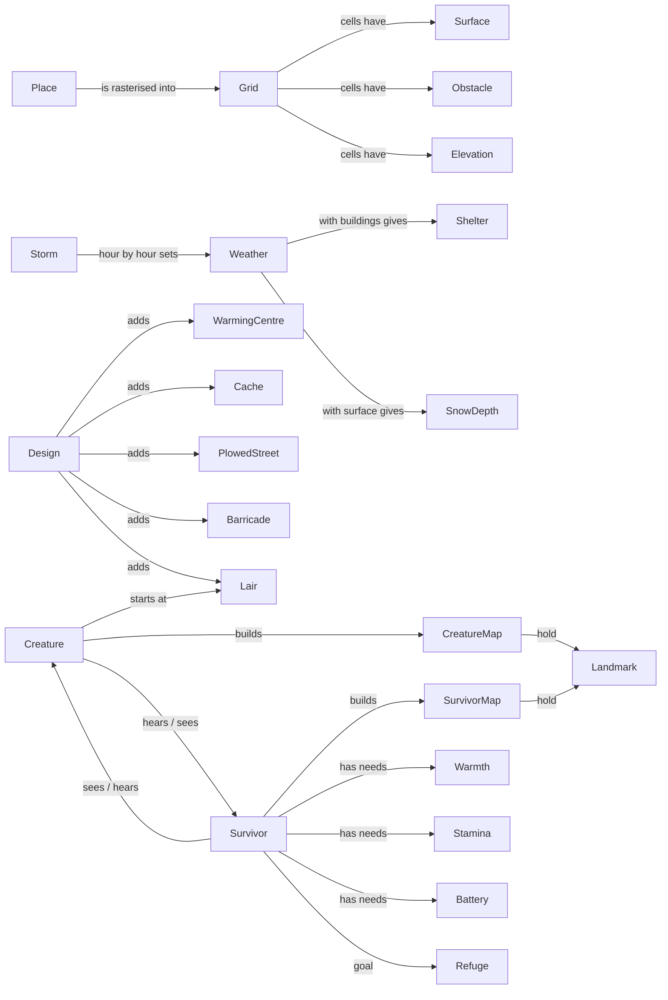

# Frostroot: Whiteout — semantic model

**Spatial idea.** On a real New York block during a real blizzard, *staying alive is a spatial problem*: where the wind cannot reach you, where the snow is shallow, where there is warmth, light and supplies, and where the thing hunting you cannot hear or see you. Survivors must reach a refuge before the cold gets them. A creature maps the neighbourhood and hunts them by sound. The environment designer (you) arranges the emergency response on top of the real place and watches what it does to the agents.

The model below is what the simulation encodes. Names in `code` are the identifiers used in `src/`.

## 1. The place (physical, real, fixed)

| Concept | What it is | Source | Code |
|---|---|---|---|
| **Place** | A 640 m × 480 m piece of Manhattan: Morningside Heights, Central Park's Ramble, or Lower Manhattan | `src/data/places.js` | `PLACES` |
| **Grid** | The place as 8 m × 8 m cells (80 × 60). x runs east, y runs south | projection in `city.js` | `makeGeo`, `buildCity` |
| **Building** | A footprint polygon with a surveyed roof height and ground elevation (metres) | NYC Open Data *Building Footprints*; OSM where the city has none | `world.buildings`, `G.BLDG` |
| **Street / path / steps / plaza** | Open ground with a name; width by class (avenue 26 m, street 17 m, path 4 m) | OpenStreetMap ways | `S.AVENUE`, `S.STREET`, `S.PATH`, `S.STEPS` |
| **Lawn / woods / water / rock / fence** | Park surfaces, tree trunks, the Lake, outcrops and cliffs, fences and hedges | OpenStreetMap areas and lines | `S.LAWN`, `G.TREE`, `G.WATER`, `G.ROCK`, `G.FENCE` |
| **Elevation** | Ground height of every cell (m above sea level) | building ground elevations (survey) blended with the Copernicus 90 m DEM | `world.elev` |
| **Street light** | Lit cells: OSM street lamps, and every avenue and street | OSM | `world.lit` |
| **Street corner** | Where two named streets meet ("Amsterdam Av & W 116th St") | OSM names | `world.corners` |
| **Shop doorway, subway entrance, shelter** | Places with a little warmth | OSM points | `world.pois` |
| **Refuge** | Mount Sinai Morningside / 81 St–Museum of Natural History subway / NewYork-Presbyterian Lower Manhattan Hospital | OSM | `world.refuge`, `world.door` |

## 2. Time: the storm (dynamic)

| Concept | What it is | Code |
|---|---|---|
| **Storm** | The January 2016 blizzard (Jonas), hourly from the ERA5 reanalysis via Open-Meteo: temperature, apparent temperature, wind speed, gusts, direction, snowfall, snow depth | `place.weather`, `STORM` |
| **Night** | 12 hours of that record, starting at a chosen hour (default 23 Jan 17:00). One round = one night. Or *tonight*, from the live forecast | `config.night`, `weatherAt(world, t)` |
| **Wind chill** | Environment Canada / NWS formula from temperature and the *local* wind | `windChill(T, v)` |
| **Shelter** | 0–1 per cell, for the current wind direction: in the lee of a building up to ≈ 4 × its height, less behind trees and fences | `shelterFor(world, dir)` |
| **Snow depth** | Recorded depth × drift by surface (lawns more, avenues less) × lee; plowed streets ≈ 15 % | `snowDepthCm` |
| **Visibility** | Every sight range × 1 / (1 + 0.3 × snowfall in cm/h) | `visibility(w)` |

## 3. Location: frames of reference

An agent's position is one cell, held in several frames (`describeLocation`):

1. **Grid**: `(x, y)` cell indices.
2. **Metric local**: metres east and south of the map's north-west corner.
3. **Geographic**: longitude and latitude (WGS84), by inverting the projection (`geo.toLonLat`).
4. **Street**: the nearest named way and the nearest other one: "W 113th St, near Amsterdam Av".
5. **Landmark-relative** (in each agent's memory): every landmark is stored as an offset in metres from the landmark made before it: "K4: 48 m E, 32 m S of W1". There are no global coordinates in an agent's memory.
6. **Vertical**: elevation of the ground under it (m), which matters for sight (the terrain blocks rays) and effort (climbing).

## 4. Distance: several metrics

| Metric | Definition | Used for |
|---|---|---|
| **Euclidean** | straight line in metres; also in 3D with the elevation difference | sight range, catching |
| **Walking (path)** | Dijkstra on the agent's *own* map, 8 directions, unknown ground counts as blocked | every route an agent plans |
| **Effort / cold** | walking distance + snow depth / 40 per cell + (when cold) wind exposure + danger near the creature + marked dead ends | survivors' routes (`costFor`) |
| **Acoustic** | straight 3D line + muffling for every cell of material it passes through (building 8, rock 5, terrain 4, tree 1.2, bush 1, fence 0.3), × (1 − 0.3 × wind/35 × cos θ): shorter downwind, longer upwind | hearing (`acoustic`) |
| **Expected heat loss** | walking distance ÷ speed × current loss rate | planning ahead: is the refuge reachable before freezing? |

## 5. Agents

### The creature (one)
- **Senses**: a 100° cone, 7 cells (56 m) in clear air, blocked by buildings, trees and rising ground, shortened by snowfall; it sees a survivor under a street light 1.6× farther, one with a flashlight on 1.3× farther. It hears footsteps within an acoustic distance of 13 cells (shrunk by gusts; walking steps count 6 cells farther than running ones).
- **Knowledge**: its own map (`known`: unseen / open / obstacle), its trajectory, landmarks: lair, street corners, dead ends (cul-de-sacs), warm places, the refuge door, sounds heard, catches, frozen survivors.
- **Goal 1, phase 1**: map the neighbourhood. *Performance*: share of open ground seen, metres walked.
- **Goal 2, phase 2**: catch survivors. *Performance*: share of survivors caught (`creatureScore`).
- **Planning**: frontier exploration (nearest edge of the known, preferring straight ahead); shortest routes on its own map to a sound; sweeps the dead ends and warm places it remembers near where it lost the trail.
- **Spatial memory that improves decisions**: between sounds it patrols its landmarks, weighted by how many survivors it has heard and caught near each one in earlier nights.

### The survivors (one to five per night; they take up space: two never share a cell)
- **Senses**: a 110° flashlight cone, 6 cells (only 2.5 with the battery empty or the light off), blocked like the creature's; street lights let it see without the flashlight. Hears the creature moving within 11 acoustic cells.
- **Knowledge**: starts with nothing but the bearing of the refuge ("the hospital is that way"). Builds its own map and landmarks: street corners, dead ends (never flee into one), warm places, caches, the refuge, where it saw the creature.
- **Needs**: *warmth* (lost with the wind chill, more when wading in deep snow, less when running or with hand warmers; gained at warm places), *stamina* (spent per cell, more in deep snow, running and climbing; recovered at rest), *battery* (spent with the flashlight on).
- **Goal**: reach the refuge. *Performance*: reached (100) / lasted till dawn (60) / froze or caught (0), + 0.15 × warmth kept, − a little for hours spent out (`survivorScore`). Also: time, metres walked, minimum warmth, caches used.
- **Planning ahead**: before heading for the refuge it estimates the heat it will lose on the way; if it would arrive too cold, it detours to the nearest warm place it remembers first. It goes for batteries or food it has seen when those needs run low, and grabs a cache that is close.

## 6. Obstacles, hindrances, affordances

| Kind | Elements |
|---|---|
| **Obstacles** (block movement) | buildings, tree trunks, bushes, rocks and cliffs, fences, water, barricades (designer), the map edge |
| **Hindrances** (penalty) | deep snow (slower, tiring, wet), wind exposure (cold), slopes and steps (tiring), street light (you are seen), long open lawns, dead ends |
| **Affordances** (bonus) | warming centres (designer, +2.2 warmth/tick), subway entrances and shelters (+0.7), shop doorways (+0.3), caches (designer: batteries, hand warmers, food), plowed streets (designer: little snow), the lee of buildings and woods |

Several elements are both: a plowed avenue is fast but lit and exposed; a warming centre saves lives but is lit, and the creature learns that survivors gather there.

## 7. The environment

Physical (a real place), **partially observable** (both kinds of agents see only a cone and build their own maps), **multi-agent** (one creature and several survivors that take up space), **dynamic** (the weather and the snow change every hour of the night; caches are taken), **non-deterministic** (where survivors wake, the creature's patrol choices; seeded, so a seed replays exactly).

## 8. The environment designer

A **design** is JSON (`src/sim/design.js`): `lair`, `warming[]`, `caches[{cell, type}]`, `plowed[street names]`, `barricades[{cell, dir}]`, within a **budget** of 14 points (warming centre 3, cache 1, plowed street 2, barricade 1).

- **Manual**: two variations of the current design are played for the same nights (same seeds); the user chooses one; two new variations are made from it; the lineage is kept.
- **Automated**: for E epochs, make P variations of the best design so far, evaluate each over N nights, keep the best by the chosen objective (help the survivors, or help the creature). E × P environments are generated and evaluated.
- **Evaluation** (`evaluateDesign`): the aggregate performance over all survivors of all nights: rates of reaching the refuge, being caught, freezing, lasting till dawn; warmth kept; caches used; and the paths, endings and heatmap for drawing.
